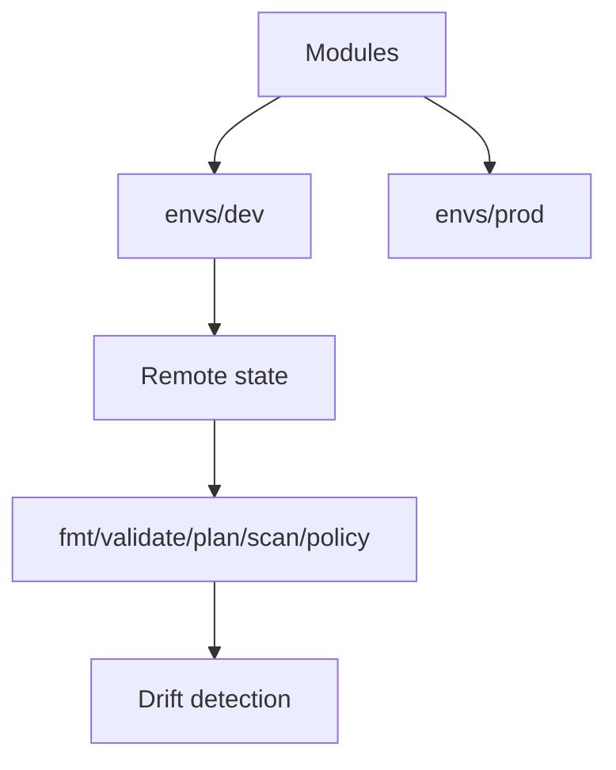

# 05. Terraform/OpenTofu Infrastructure Automation


**Terraform · OpenTofu · OPA** · *Phase 2 — Intermediate delivery* · `lab`.

> Reusable modules, remote state, env separation (dev/staging/prod), drift detection and policy checks. Both `terraform` and `tofu` CLIs work.

## Contents

1. Outcomes 2. Architecture 3. Prerequisites 4. Repo map 5. Step 0 clone 6. Step 1 local validate (no backend) 7. Step 2 remote state 8. Step 3 dev apply 9. Step 4 prod promotion 10. Step 5 drift + policy 11. CI 12. Teardown 13. Troubleshooting

## 1. Outcomes

- `terraform/modules/network` versioned once, consumed by `envs/dev` and `envs/prod`.
- S3 + DynamoDB lock (or Tofu backend), per-env tfvars/state, `plan` artifact review.
- OPA/Checkov gates + scheduled drift `plan`.

## 2. Architecture



## 3. Prerequisites

- terraform >=1.6 **or** opentofu >=1.6, awscli or doctl (only for real backend), jq.
- macOS: `brew install terraform opentofu`. No cloud for Steps 0–1.

## 4. Repository map

```
terraform/modules/network/main.tf  # reusable VPC module (cidr var/output)
terraform/envs/dev/main.tf         # module call dev
terraform/envs/prod/main.tf        # module call prod
policy/s3.rego                     # example policy
```

## Step 0 — Clone

```bash
git clone https://github.com/navin-kumar10/terraform-opentofu-automation.git
cd terraform-opentofu-automation
bash tests/smoke.sh
find terraform policy -type f | sort
```

## Step 1 — Validate without backend

```bash
terraform -chdir=terraform/modules/network init -backend=false
terraform -chdir=terraform/modules/network validate
terraform fmt -check -recursive
# tofu parity:
tofu -chdir=terraform/modules/network init -backend=false 2>&1 | head -3 || echo "tofu optional"
```

## Step 2 — Configure remote state (when ready for cloud)

S3 example `terraform/envs/dev/backend.tf` (create once, do not commit creds):

```hcl
terraform {
  backend "s3" {
    bucket         = "lab-tfstate-ACCOUNT"
    key            = "dev/terraform.tfstate"
    region         = "us-east-1"
    dynamodb_table = "lab-tflock"
    encrypt        = true
  }
}
```

```bash
aws s3 mb s3://lab-tfstate-ACCOUNT --region us-east-1
aws dynamodb create-table --table-name lab-tflock --attribute-definitions AttributeName=LockID,AttributeType=S --key-schema AttributeName=LockID,KeyType=HASH --billing-mode PAY_PER_REQUEST --region us-east-1
```

## Step 3 — Dev apply

```bash
terraform -chdir=terraform/envs/dev init
terraform -chdir=terraform/envs/dev plan -out=tfplan
terraform -chdir=terraform/envs/dev apply tfplan
```

Verify outputs (cidr), then `terraform -chdir=terraform/envs/dev output`.

## Step 4 — Promote to prod

1. Tag module version: `git tag modules/network/v0.1.0`.
2. Bump `envs/prod` source to tag.
3. PR → CI plan for both envs → merge → apply dev → smoke → approval → apply prod.

Never `apply prod` from laptop without PR + plan artifact.

## Step 5 — Drift + policy

```bash
terraform -chdir=terraform/envs/dev plan -detailed-exitcode
# 0=no change, 2=drift. Schedule nightly in Actions.
opa eval --data policy/s3.rego --input <(echo '{"bucket":"x"}') 'data.lab.deny' 2>&1 | head -5 || echo "opa optional"
checkov -d terraform 2>&1 | head -20 || echo "checkov optional"
```

Add Infracost in CI for cost diff on PR.

## CI

`terraform.yml` runs fmt/init/validate on `terraform/**`. Extend with `plan` per env + artifact upload + Checkov + OPA.

## Teardown

```bash
terraform -chdir=terraform/envs/dev destroy
terraform -chdir=terraform/envs/prod destroy 2>/dev/null || true
# optionally delete state bucket/table after empty
```

## Troubleshooting

| Symptom | Cause | Fix |
|---|---|---|
| `Backend init failed` | bucket/table missing | create per Step 2, check region |
| `LockID` stuck | interrupted apply | verify no apply running, `force-unlock <id>` |
| `fmt -check` fail in CI | whitespace | `terraform fmt -recursive` locally |

Foundation for 01/03/06/08. MIT — LICENSE.
