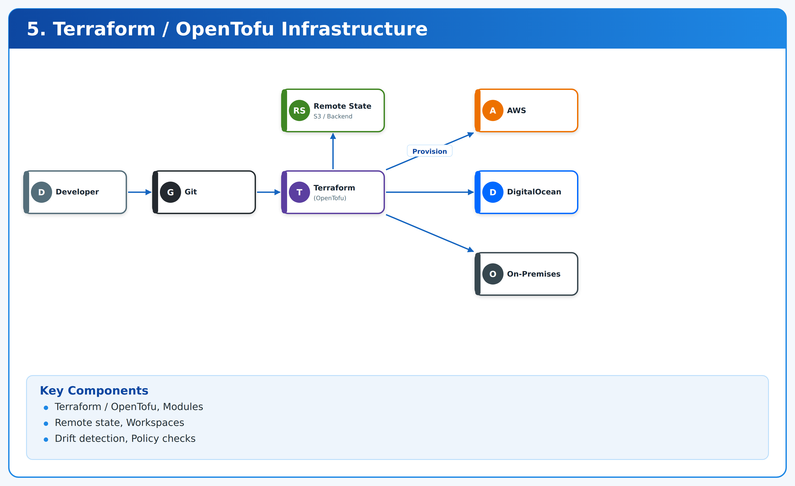
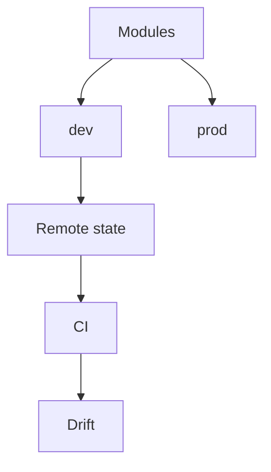

# 05. Terraform/OpenTofu Infrastructure Automation



**Terraform - OpenTofu - OPA** | *Phase 2 - Intermediate delivery* | `lab` - verify before production use.

> Reusable modules, remote state, env separation, drift detection and policy checks (OPA/Checkov).

## Architecture



Full diagram: [docs/architecture.png](docs/architecture.png) - Design: [docs/architecture.md](docs/architecture.md)

## Structure

```
.
+-- app/
+-- terraform/ or infrastructure/
+-- monitoring/
+-- tests/
+-- runbooks/
+-- docs/architecture.md, architecture.png, cost-estimate.md
+-- .github/workflows/
```

## Quickstart (lab)

```bash
git clone https://github.com/navin-kumar10/terraform-opentofu-automation.git
cd terraform-opentofu-automation
make validate
make plan
make apply
make smoke
make destroy
```

See [runbooks/DEPLOYMENT.md](runbooks/DEPLOYMENT.md), [runbooks/ROLLBACK.md](runbooks/ROLLBACK.md), [docs/cost-estimate.md](docs/cost-estimate.md).

## Implementation order

10-project portfolio. Order: Phase 1 (04,07,09) -> Phase 2 (03,04,05) -> Phase 3 (01) -> Phase 4 (02) -> Phase 5 (08,09,10).

## License

MIT - see LICENSE.
